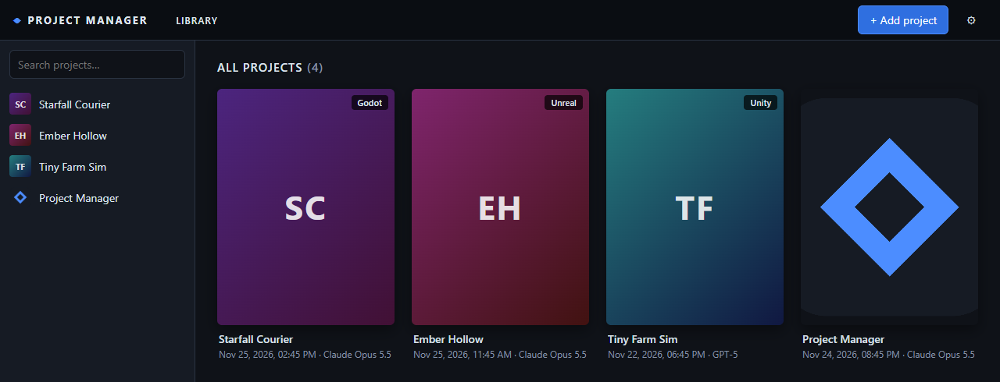
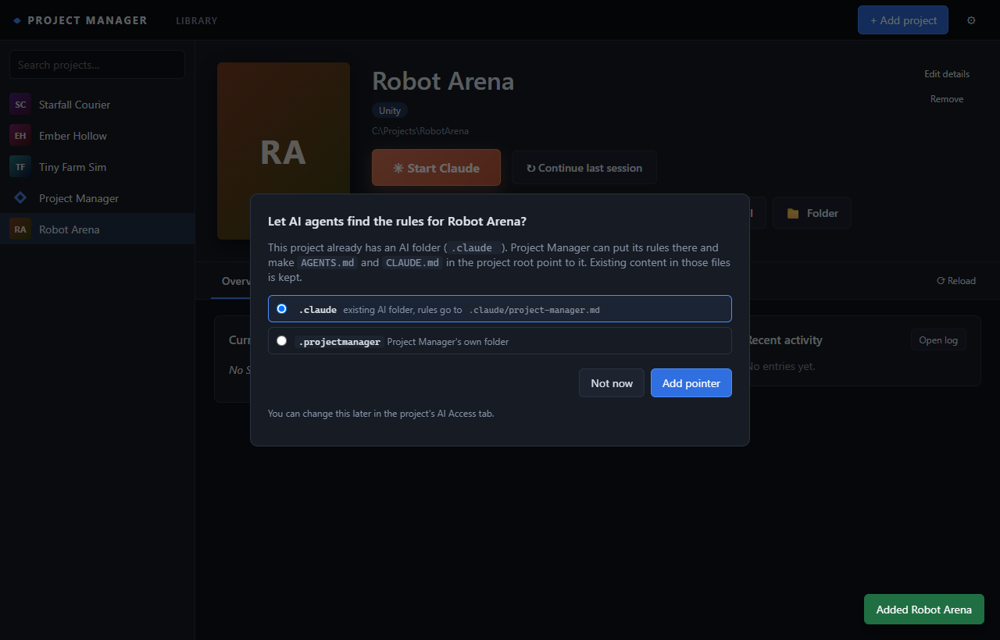
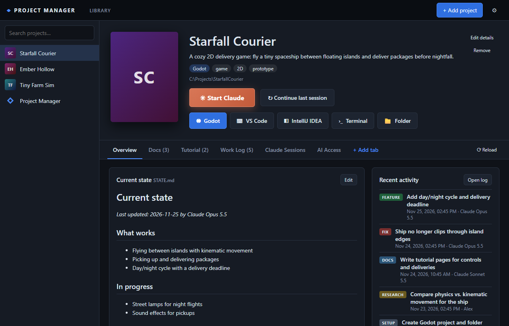
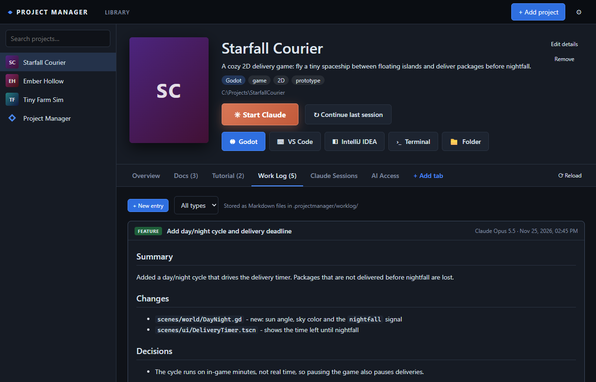
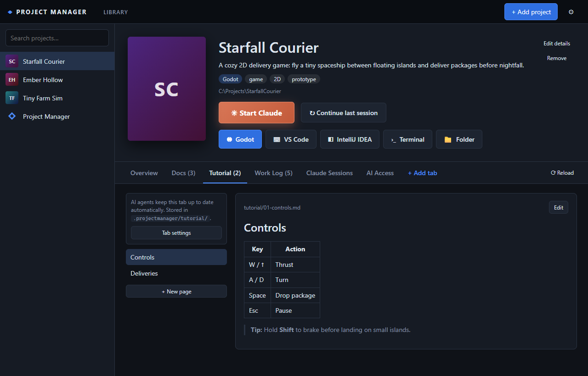
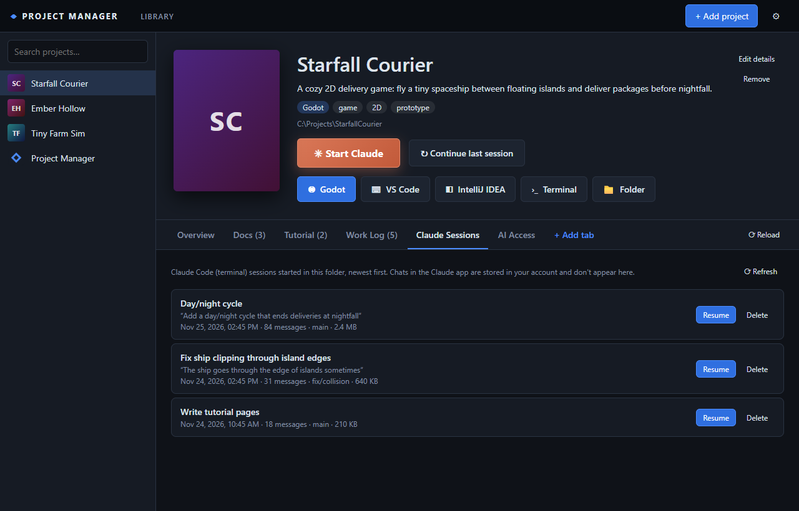
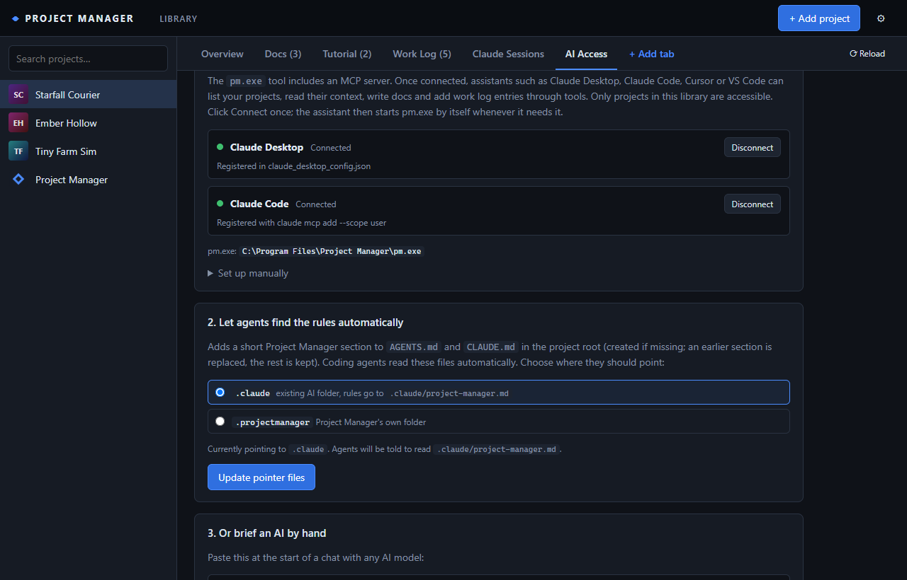

# Project Manager

**One shared memory for every AI agent that works on your project.**
Claude, Codex, Gemini, Cursor, Copilot or you by hand: everyone reads the same documentation and
work log and keeps it up to date, so each agent knows what the others did.



## Why this exists

The main purpose of Project Manager is to keep **all of a project's information in one place**,
whatever tool or AI agent is working on it.

Every AI coding agent stores its memory and instructions differently: Claude Code uses `CLAUDE.md`
and `.claude/`, Cursor uses `.cursor/`, Gemini uses `.gemini/`, Codex uses `AGENTS.md`, and chat
apps keep their history in your account. When several agents work on the same project, this
causes problems:

- **Each agent only knows its own history.** What Claude did yesterday is invisible to Codex today,
  so decisions get undone, work gets repeated and you end up explaining everything again.
- **Project knowledge is scattered.** Progress, decisions and known bugs end up spread across
  different agents' memory files and chat histories that you can't search and that disappear.
- **Switching agents means starting from zero.** You can't simply use whichever agent fits the
  task best, because none of them knows the full picture.

Project Manager solves this with **one shared, agent-neutral memory per project**: a
`.projectmanager/` folder with plain Markdown files that any agent can read and write. Every agent
is pointed to the same rules (through `AGENTS.md`, `CLAUDE.md` or its own AI folder), reads the same
state and work log before it starts, and writes its own entry when it finishes. Multiple agents can
work on one project one after another and **keep each other up to date**, as if they were teammates
sharing one project wiki.

The shared memory consists of these files:

| File | What it holds |
|---|---|
| `STATE.md` | a short, always-current snapshot: what works, what's in progress, known problems |
| `worklog/` | one entry per work session: what was done, why, decisions, open issues, next steps |
| `docs/` | documentation pages (and extra tabs such as a player Tutorial) |
| `AGENTS.md` | the rules that tell any AI agent to read the above first and log its work afterwards |

AI assistants read this memory at the start of a session and update it at the end, either through
the built-in **MCP server** (`pm.exe`), the `pm` command line tool, or by editing the files directly.
Each work log entry records its author (for example `Claude Opus 5.5`, `GPT-5` or your name), so you
always see which agent did what. Every new session starts with full context, no matter which agent
ran the last one.

On top of that, each project gets a page, like a game in Steam, with one-click buttons to open it in
its engine, IDE, a terminal or Claude Code.

**In short:** use it when several AI agents (and you) work on the same projects, and you want all of
them to share one source of truth, so each one picks up exactly where the last one stopped.

> Windows only for now (editor detection, launching and Claude integration use Windows paths).

## A tour of the interface

### 1. Library

All your projects as cover cards, with the engine badge and the last activity (when and by whom).
Search by name, tag or engine in the sidebar. Click **+ Add project** and pick any folder to add it.

### 2. Add a project

When you add a folder, Project Manager creates `.projectmanager/` inside it and offers to add a short
pointer to `AGENTS.md` / `CLAUDE.md` in the project root, so coding agents find the rules
automatically. If the project already has an AI folder (such as `.claude`), the rules can go there.



### 3. Project page

Each project has a hero section with its cover, description and tags, and launch buttons:

- **✳ Start Claude** opens a terminal in the project folder running Claude Code;
  **Continue last session** resumes the most recent one.
- **Engine and editor buttons** (Godot, Unity, Unreal, VS Code, IntelliJ IDEA) open the project in that
  program. Engine buttons only show when the project uses that engine, and Unity opens the exact
  editor version the project needs.
- **Terminal** and **Folder** open PowerShell or File Explorer in the project folder.

The **Overview** tab shows the current `STATE.md` (click **Edit** to change it) and the latest work
log entries. Click the cover to change it, or **Edit details** to change the name, description,
engine and tags.



### 4. Work Log

Every work session, by you or an AI, gets an entry with a type (feature, fix, docs, research...),
an author, the time, and sections for *Summary*, *Changes*, *Decisions*, *Known issues* and
*Next steps*. Click an entry to expand it, filter by type, or add one by hand with **+ New entry**.
The log is append-only: entries are never edited, so the history stays trustworthy.



### 5. Docs and custom tabs

**Docs** holds documentation pages written in Markdown. With **+ Add tab** you can add more sections,
for example a **Tutorial** for players, a **Game Design** document or a **Changelog**. Each tab has
its own instructions for AI agents, so agents keep it up to date as the project changes.



### 6. Claude Sessions

Lists the Claude Code sessions that were started in the project folder, with name, first prompt,
message count, git branch and size. **Resume** continues a session in a new terminal; **Delete**
removes a transcript you don't need anymore.



### 7. AI Access

Connect AI assistants once and they can work with all projects in your library:

1. **Connect** Claude Desktop and/or Claude Code to the built-in MCP server with one click.
   (Other MCP clients such as Cursor or VS Code can be set up manually.)
2. **Add pointer files** so coding agents read the rules automatically.
3. Or **copy a ready-made prompt** to brief any AI chat by hand.



### A typical day

1. Open Project Manager and click your project.
2. Read **Current state** and **Recent activity** to see where things stand.
3. Click **✳ Start Claude** and ask for the next feature. The agent reads `STATE.md`, the latest work
   log entries and the docs on its own.
4. When the agent finishes, it adds a work log entry and updates `STATE.md` and the docs.
5. Later, switch to a different agent (say Codex or Gemini) for another task. It reads the same
   files, sees what Claude just did and why, and continues from there. Its own entry then tells
   the next agent what it changed.

---

## First-time setup (Windows)

Install these once:

1. **Node.js** (LTS): https://nodejs.org
2. **Rust**: https://rustup.rs (run `rustup-init.exe`, accept the defaults)
3. **Microsoft C++ Build Tools**: https://visualstudio.microsoft.com/visual-cpp-build-tools/
   In the installer, tick **"Desktop development with C++"**.
   (If Visual Studio with C++ is already installed, you can skip this.)
4. **WebView2** is already part of Windows 10 (recent updates) and Windows 11.

Restart your terminal afterwards so `node`, `npm` and `cargo` are on the PATH.

## Run it

In this folder:

```powershell
npm install
npm run tauri dev
```

The first start compiles the Rust part and takes a few minutes; later starts are fast.

## Build an installer

```powershell
npm run tauri build
```

The `.exe` and installer end up in `src-tauri\target\release\` and `src-tauri\target\release\bundle\`.
This also builds `pm.exe` (see below).

## `pm.exe`: command-line tool and MCP server for AI assistants

Build it once (and again after updates):

```powershell
npm run build:pm
```

It ends up in `pm\target\release\pm.exe`.

**Connecting assistants:** open any project's **AI Access** tab and click **Connect** next to
Claude Desktop or Claude Code (or run `pm connect claude-desktop` / `pm connect claude-code`).
- Claude Desktop: the entry is added to `claude_desktop_config.json` in every location Claude
  Desktop uses (normal and Microsoft Store install). A backup
  (`claude_desktop_config.backup-<time>.json`) is saved next to each file first; other settings
  are kept. Quit Claude Desktop from the tray icon and start it again afterwards.
- Claude Code: runs `claude mcp add --scope user project-manager -- <pm.exe> mcp`.

The assistants start `pm.exe mcp` themselves; you never run it by hand.

| Command | What it does |
|---|---|
| `pm list` | list registered projects |
| `pm context [PROJECT]` | print a briefing: state, recent work log, docs |
| `pm log [PROJECT] --author .. --type .. --title .. --summary ..` | add a work log entry (`--changes`, `--decisions`, `--issues`, `--next` optional) |
| `pm add FOLDER` | register a folder |
| `pm mcp` | run the MCP server over stdio (started by the assistant) |
| `pm connect CLIENT` / `pm disconnect CLIENT` | register with `claude-desktop` or `claude-code` |
| `pm status` | show which assistants are connected |

Without `PROJECT`, `pm` uses the project that contains the current directory.

MCP tools: `list_projects`, `get_project_context`, `list_worklog`, `add_worklog_entry`,
`update_state`, `list_docs`, `read_doc`, `write_doc`. Only projects in the library are accessible.

## What's stored where

| Location | Content |
|---|---|
| `<project>\.projectmanager\project.json` | name, description, engine, tags, cover file name |
| `<project>\.projectmanager\STATE.md` | short snapshot of the project's current state |
| `<project>\.projectmanager\AGENTS.md` | rules for AI agents: what to read, how to log |
| `<project>\.projectmanager\docs\*.md` | documentation / tutorial pages |
| `<project>\.projectmanager\worklog\*.md` | one file per work session (append-only) |
| `<project>\.projectmanager\cover.png` | cover image |
| `%APPDATA%\local.projectmanager.app\library.json` | which project folders are in your library |
| `%APPDATA%\local.projectmanager.app\settings.json` | editor paths |

Removing a project from the library never deletes files.

## Extra tabs (e.g. Tutorial)

Click **+ Add tab** on a project page to add a tab next to Docs and Work Log. Presets:

| Preset | Purpose |
|---|---|
| Tutorial | how to play the game, written for players |
| Game Design | vision, core loop, mechanics, decisions |
| Changelog | player-facing release notes |
| Custom | any name and your own instructions |

A tab's pages are Markdown files in `.projectmanager/<tab-id>/` (e.g. `.projectmanager/tutorial/`),
listed in `project.json` under `tabs`. The tab's **instructions for AI agents** are written into
`.projectmanager/AGENTS.md` ("Extra sections"), and adding a tab also logs a work log entry asking the
next agent to fill it, so agents maintain the tab automatically. Removing a tab keeps its files.

## How AGENTS.md is maintained

`.projectmanager/AGENTS.md` has a generated block between `<!-- project-manager:rules:start -->`
and `<!-- project-manager:rules:end -->`. Project Manager rewrites that block when needed (new
version, tabs added or removed) whenever the project is opened in the app, `pm context` runs or an
agent calls `get_project_context`. Everything below the end marker ("Project-specific rules") is
kept. Older files without markers are converted once: lines that were added to the old template are
moved to "Project-specific rules", and a backup `AGENTS.backup-<time>.md` is saved first.

## Work log times

AI models have no clock. The MCP tool and `pm log` stamp entries with the real local time, and the
rules tell agents that write files by hand to read the system clock first. As a safety net, the app
compares each entry's time with the file's real creation time: if an entry claims a time later than
its file was written, the file's time is shown instead, marked with ⏱. The file itself is not changed.

## Claude Code sessions

The **Claude Sessions** tab lists the Claude Code (terminal) sessions started in the project
folder. Claude Code stores them as `%USERPROFILE%\.claude\projects\<folder-path-with-dashes>\<id>.jsonl`.
Each session shows its name, summary or first prompt, last activity, message count and git branch.

- **Resume** opens a terminal in the project folder running `claude --resume <id>`.
- **Delete** removes the transcript (and its subagent folder) after a confirmation. This cannot be undone.

Chats from the Claude app (Desktop, web, mobile) are stored in your Claude account, not on disk,
so they don't appear here. The transcript format is internal to Claude Code; Project Manager reads
only a few fields and skips lines it doesn't understand.

## Pointing AI agents to the rules

After adding a project, Project Manager offers to add a short section to `AGENTS.md` and
`CLAUDE.md` in the project root (also available in the AI Access tab). `.projectmanager/` is
always created; the pointer target can be:

- an existing AI folder such as `.claude`, `.cursor`, `.windsurf`, `.gemini`, `.codex`, `.junie`,
  `.kiro`, `.roo`, `.clinerules`, `.continue`, `.amazonq`, `.agents`, `.agent` or `.ai`: the rules
  are written to `<folder>/project-manager.md` and the root files point there;
- `.projectmanager`: the root files point to `.projectmanager/AGENTS.md`.

The section is wrapped in `<!-- project-manager:start -->` / `<!-- project-manager:end -->`, so it
can be replaced later without touching the rest of the file.

## Editor launching

| Button | Shown when | How it starts |
|---|---|---|
| VS Code | always | `Code.exe <folder>` (auto-detected) |
| IntelliJ IDEA | always | `idea64.exe <folder>` (auto-detected in Program Files / Toolbox) |
| Unity | `ProjectSettings\ProjectVersion.txt` exists | the matching version from Unity Hub: `Unity.exe -projectPath <folder>` |
| Unreal | a `*.uproject` file exists | `UnrealEditor.exe <file>`, or the file association if no path is set |
| Godot | `project.godot` exists | `godot.exe --editor --path <folder>` (set the path in Settings) |
| **Start Claude** (highlighted) | Claude Code is installed | PowerShell in the project folder (inside Windows Terminal if installed), running `claude` |
| Continue last session | the folder has Claude Code sessions | same, running `claude --continue` |
| Terminal | always | PowerShell in the project folder |
| Folder | always | File Explorer |

Programs are started directly with argument lists, never through a shell.

## Code layout

```
pm/                      shared Rust crate "pm-core" + the pm.exe tool
  src/project.rs         reading/writing .projectmanager (meta, state, docs, worklog, cover)
  src/library.rs         library.json, finding projects by name or path
  src/context.rs         the AI briefing (get_project_context / pm context)
  src/mcp.rs             MCP server (JSON-RPC over stdio) and its tools
  src/connect.rs         registering pm.exe with Claude Desktop / Claude Code
  src/sessions.rs        listing and deleting Claude Code sessions of a project
  src/templates.rs       AGENTS.md / STATE.md / overview templates
  src/main.rs            pm.exe command-line interface
src/                     React frontend
  App.tsx                top bar, sidebar, routing between library and project
  api.ts                 typed wrappers for the Rust commands
  components/            Library, ProjectView, DocsPanel, WorklogPanel, AiPanel, SettingsDialog
src-tauri/src/
  lib.rs                 Tauri commands (the API the frontend calls)
  launch.rs              editor detection and launching
  settings.rs            settings.json; library via pm-core
docs/screenshots/        images used in this README (demo data, not real projects)
```

Note: This project was created using claude, and I have only worked with Claude on this so far. Thus you might notice that this software has much more support for claude than for other AIs. Feel free to fork this project and to extend the code. 
